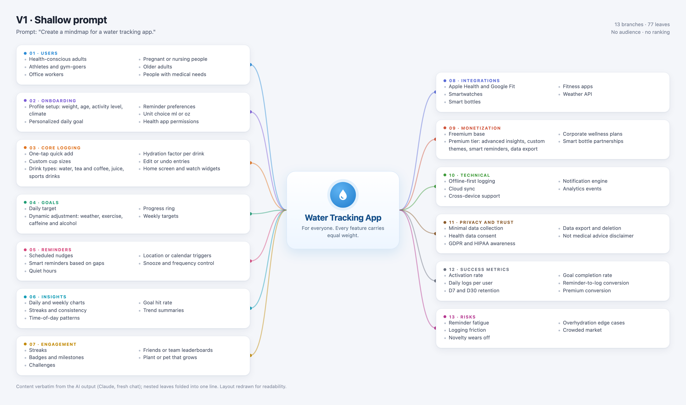
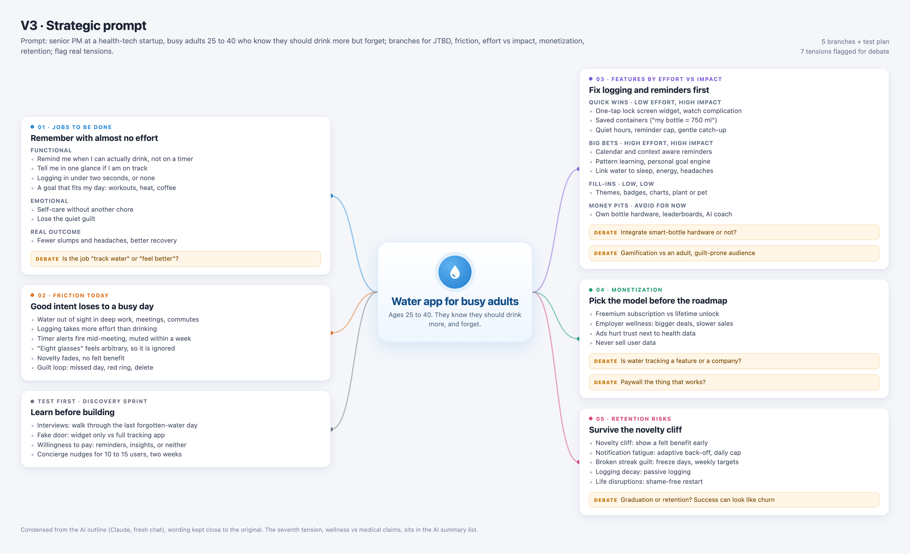

# Strategic Discovery Map (Module 1)

## Responses
- **Write one feature from the map that, if an engineer asked “why is this a priority for our 12-week roadmap?”, you honestly could not give a strategic answer for.:** The virtual plant or pet that grows, from the Engagement branch. Nothing in the map says who asked for it, which metric it moves, or why it should come before one-tap logging and reminders. The same map names those two as what decides week-one retention. It also costs design and animation work. My only answer to the engineer would be "other apps have one", and that is not a reason.
- **Write one feature that looks “correct” for the app but has zero strategic weight, you have no idea if it helps the company make money or whether a single user actually asked for it.:** Drink types with hydration weighting (tea, coffee, juice, sports drinks). It looks rigorous. But the same map's Problems branch says self-reported data is unreliable, because people guess sizes and log from memory. Weighting adds precision on top of a guess. No user need in the map asks for it, and it is not tied to any revenue line.
- **Compare V3 to your Step 1 baseline. What changed, and is the output objectively better, did the AI get smarter, or did your added PM knowledge (JTBD, effort/impact, retention) force it to be useful?:** V1 gave 13 branches and 77 leaves for everyone, all with equal weight. V3 starts from one claim about the audience: busy adults who know they should drink more, and forget. So the job is remembering, not measuring. V3 sorts features into quick wins, big bets, fill-ins and money pits. It names seven tensions to settle before any roadmap, such as whether to put the reminders that drive retention behind a paywall. The plant or pet that sat unquestioned in V1 is now a low-impact fill-in, flagged as a risk for an adult audience. V3 is more useful, but not more true. Its effort and impact ranks are guesses, and it says so. Its numbers have no source and do not agree with each other: novelty fades in "two to three weeks" in one branch and "weeks 2 to 4" in another (V2 said one to two). The AI did not get smarter. It was the same model, in a fresh chat each time. What changed was the prompt: I gave it a segment, a problem, and the frameworks (JTBD, effort vs. impact, retention).
- **Key takeaway: how does this prove the PM’s role is to think while the AI’s role is to execute?:** The AI organized whatever I gave it. Every choice that made V3 useful came from my prompt: who the app is for, which problem to solve, and how to rank the work. V3 then handed the hardest decisions back to me as open tensions, and its numbers still needed checking. The PM decides what matters and checks the result. The AI does the drafting.

---

## The maps

V1 and V3 from fresh chats. V1 is drawn verbatim from the AI output. V3 is condensed from the AI outline, wording kept close.

**V1 · shallow prompt:** 13 branches, 77 leaves, no audience, no ranking.

**V3 · strategic prompt:** a defined audience, features ranked by effort and impact, tensions flagged for debate.

