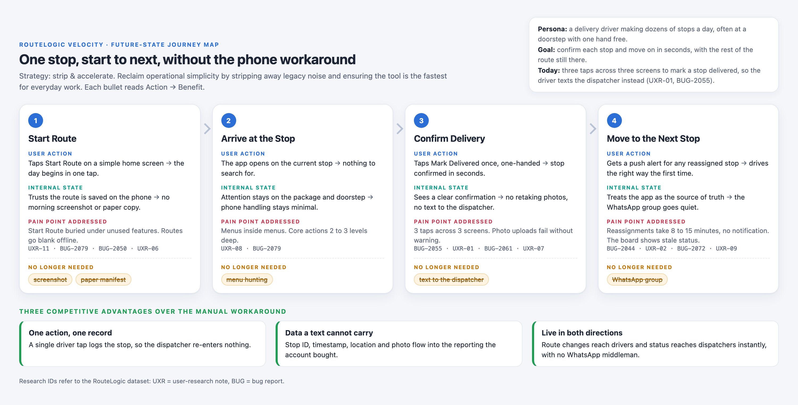

# Competitive Analysis & Journey Map

RouteLogic Velocity.

Module 3's funnel and CSAT evidence moved the priority from driver delivery confirmation to coordinator compliance logging. B1 addresses that narrower workflow. The [historical driver journey](#historical-baseline-the-original-driver-journey) records the evidence behind the initial choice.

## Responses

### Persona

#### Role

A fleet coordinator, called a dispatcher in the interviews, who assigns routes, logs compliance checks and hands off shifts each day.

#### Goal

Finish the daily compliance record in RouteLogic, with each answer recorded and the record available to the managers who rely on it.

#### Friction and validation

The Module 3 scenario reports **mean compliance logging time of 14.6 minutes against a 3-minute benchmark**. Workflow completion falls from 71% at route assignment to 48% at compliance. Coordinators rate Compliance 2.2 out of 5 while 77% use it daily. These signals justify investigating this step first. They do not establish how much time a faster form can remove. [Hypothesis and metrics](../03-analytics/hypothesis-and-metrics.md).

No interview describes compliance logging. The current screens, repeated data entry and use of paper for compliance are unverified. Under VEL-01's **pre-build evidence gate**, observe five current-flow sessions per pilot account. Separate checking time from recording time, confirm the checklist and route fields, and verify the correction path with the compliance owner. If physical checks consume most of the time or the 12-item list does not fit, revisit B1 before approving the build estimate.

### Current workflow and workaround

#### Observed external tools

Dispatchers use a WhatsApp group as "the real system" (UXR-02) and say "I can't trust the board" (UXR-09). That establishes an off-platform coordination workaround. It does **not** establish that they log compliance in WhatsApp or on paper. The compliance workaround, if there is one, must be observed rather than inferred from the messaging complaints.

#### Workflow sequence

1. Open RouteLogic and load the fleet. The scenario funnel has 100% at open and 94% at fleet view.
2. Assign routes. 71% reach this step. This is B1's proposed entry point. Route assignment itself does not change.
3. Log compliance. 48% reach it, and its scenario mean time is 14.6 minutes. The existing screens and any copied fields are hypotheses pending observation.
4. Complete the shift handoff. 31% reach it. The funnel does not prove that compliance friction caused the later drop or that the missing work was done elsewhere.

#### Mechanism to validate

The candidate moment is the transition from an assigned route to a completed compliance log. The measurable gap is clear. The explanation to test is that avoidable recording work, rather than the checks themselves, consumes the time and discourages completion.

#### Evidence

The workflow drop, the 14.6-minute mean and the 2.2 Compliance CSAT cell establish the priority to investigate. The interviews corroborate a wider coordination problem, not its cause at compliance. Pre-build observation tests the proposed recording obstacle. [VEL-01](../05-experimentation/experimentation-plan.md) then tests B1's effect on completion and record quality.

### Proposed coordinator journey

[Coordinator journey map](journey-map.html). The prototype illustrates this proposed workflow. Completion and time improvements remain hypotheses.

| Stage | User action → benefit | Intended internal state | Friction addressed |
|---|---|---|---|
| 1. Assign the route | Assign a driver and vehicle → open compliance from the route. | I know which route I am logging. | Keeps the entry in the existing assignment flow. Missing assignments must be fixed there first. |
| 2. Check the header | Inspect six read-only route fields → avoid copying data into the log. | I can see where these details came from. | Reuses existing route data. Wrong details return to route assignment for correction. |
| 3. Answer the checks | Answer 12 blank checks and explain each Fail → record a complete response. | I know what I answered and what still needs attention. | No pre-ticked answers or bulk Pass. A Fail without its reason cannot be submitted. |
| 4. Submit and confirm | Submit once and read confirmation → know the log was recorded. | I can return to dispatch with the result visible. | Shows passes, fails and reasons. One record per route, date and shift. Corrections use the agreed audit path. |

Three advantages to validate against today's logging workflow:

1. **Route data is reused.** The header comes from the assigned route, so the proposed log requires no retyping of those six fields. Pre-build observation establishes how much copying this replaces.
2. **Completeness comes from explicit answers.** Every check starts blank and needs a response. The interface cannot supply an unchosen answer, but a tap does not prove the physical check happened. Record audits and the Fail-rate diagnostic remain necessary.
3. **The buyer keeps the record they need.** B1 is designed to preserve the existing record format and audit correction path. The compliance owner must confirm both before the pilot. The prototype demonstrates the interaction, not a production integration.

B1 does not fix driver delivery confirmation, photo uploads, offline routes, reassignment notifications or live two-way sync. Those problems remain in the research and need their own engineering decisions. [B1 PRD and exclusions](../04-roadmap/simplified-prd.md).

### The leaner rival

The account-level competitor is the leaner rival our largest account is trialing, one that "just does routing well" (UXR-04). Buyers chose RouteLogic for its reporting ("that's why we bought it", UXR-10). The proposed advantage is a faster compliance-recording step within the workflow and history the buyer already uses. A rival can copy a faster form within months. The advantage depends on workflow fit and the cost of migrating history, rather than a unique form. B1 does not resolve the separate routing and reliability reasons an account might leave.

### Historical baseline: the original driver journey

**Module 2's original choice, before the Module 3 pivot.** I chose a delivery driver making dozens of stops a day, often at a doorstep with one hand free. Seven of the 12 research notes came from drivers, plus the focus group, and 8 of the 10 bug reports hit the driver app. UXR-10 tied renewal risk to the "daily driver experience". The goal was to confirm each stop and move on in seconds, with the rest of the route still there.

The misery was directly observed: "To mark a stop delivered I tap through three screens. In the rain, at a doorstep, with a package in one hand. I've started just texting my dispatcher instead." (UXR-01). BUG-2055 called the three-tap flow the top frontline complaint and said it "drives off-platform workarounds". Five of seven focus-group drivers carried a paper manifest (UXR-12). UXR-06 described a morning screenshot. None counted the share of stops confirmed by text.

The original workaround sequence was: skip the delivery flow, text the dispatcher, drive on while the board may remain stale, and have the dispatcher update the record later. The first two steps were observed. The stale dashboard was observed separately (UXR-09, BUG-2072), but its causal link to texting was not measured. What the dispatcher did with each text was inferred.

The original four-stage future journey was **Start route → Arrive at stop → Confirm delivery → Move to next stop**. It proposed cached routes, one-tap delivery, photo confirmation and reassignment alerts. Its proposed advantages were one driver action creating one record, richer stop data and live updates in both directions. Those remain broader Velocity aspirations, not demonstrated outcomes or B1 capabilities. Texts can carry identifiers, photos and other details, but do not enforce a record structure.

Module 3 changed the priority: Drivers × Core Dispatch scored 4.3, while Coordinators × Compliance scored 2.2 and the coordinator funnel showed the largest time gap at compliance. That supports testing the coordinator bet first, not dismissing the drivers' documented failures.

The screenshot below is the original driver journey, retained as history. [The current coordinator journey HTML](journey-map.html) is authoritative for B1.

