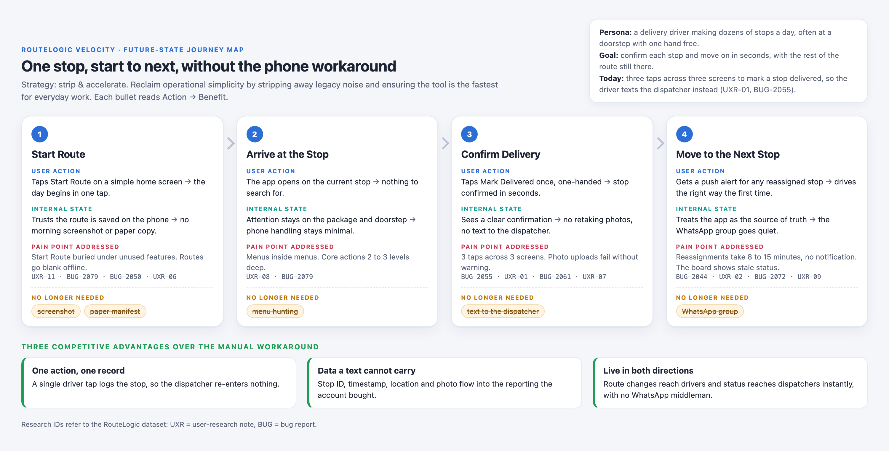

# Competitive Analysis & Journey Map

Module 2 · Deliverable 2. Scenario: RouteLogic Velocity.

## Responses

### Step 1 · Persona

**Role, who are you solving for? (the specific user segment or profile)**

A delivery driver making dozens of stops a day, often at a doorstep with one hand free.

I chose the driver over the dispatcher because that is where the evidence is. Seven of the 12 research notes come from drivers, plus the focus group, and 8 of the 10 bug reports hit the driver app. The regional manager also ties the renewal risk to "the daily driver experience" (UXR-10). The dispatcher is at the other end of the same handoff: the driver's texts land on the dispatcher's phone.

**Goal, what is this user ultimately trying to achieve?**

To confirm each stop and move on in seconds, with the rest of the route still there.

**Friction, the main barrier (moment of misery) stopping them from succeeding**

Marking a stop delivered takes three taps across three screens. The driver does it at a doorstep, in the rain, with a package in one hand, so they text the dispatcher instead (UXR-01, BUG-2055).

### Step 2 · Current workaround

**External tools, the outside platforms or tools the user is forced to use**

The driver's own phone and plain text messages to the dispatcher (UXR-01). The same drivers keep backups outside the app. They carry a paper manifest "just in case the app dies" (UXR-12) and screenshot the route every morning (UXR-06). At the other end, the dispatcher runs a WhatsApp group as "the real system" (UXR-02).

**The process, the 3 to 5 manual steps the user takes to get the job done**

1. At the door, the driver skips the three-screen "Mark delivered" flow.
2. The driver texts the dispatcher which stop is done.
3. The driver drives on, while RouteLogic still shows the stop as "in progress".
4. The dispatcher reads the text among other drivers' messages and updates the stop by hand, later, or never.

Steps 1 and 2 are observed (UXR-01). The dashboard symptom in step 3 is observed (UXR-09, BUG-2072), but the research does not show how much of it comes from texting. Step 4 is inferred: the research does not say what happens to the text.

**Core frustration, the exact moment the process feels most “broken”**

The doorstep. Three screens with a package in one hand, in the rain, is the moment the driver gives up on the app. It is also the moment the record leaves the system. A text carries no stop ID, timestamp, location or photo, so the stop exists in RouteLogic only if someone types it in again. The driver saves a few taps, and the dispatcher pays for them on every stop.

**The evidence, a specific quote or behavior from the research that proves this**

"To mark a stop delivered I tap through three screens. In the rain, at a doorstep, with a package in one hand. I've started just texting my dispatcher instead." (UXR-01). BUG-2055 logs the three-tap flow as the top frontline complaint and says it "drives off-platform workarounds". The behavior around it is wider: five of seven drivers in the focus group carry a paper manifest (UXR-12). Gap: one driver describes texting directly, and nothing counts how many stops are confirmed by text instead of in the app.

### Step 3 · Future-state journey map

**Your journey map, a shareable link, or the map file you committed (e.g. journey-map.html)**

[`journey-map.html`](journey-map.html), with a screenshot below. Four stages of one stop, from start of route to the next stop. Each stage shows the action and its benefit, the driver's internal state, the pain point it removes, and the workaround it makes unnecessary. It ends with three competitive advantages over the workaround. One action creates one record, the record carries data a text cannot, and updates flow live in both directions.

