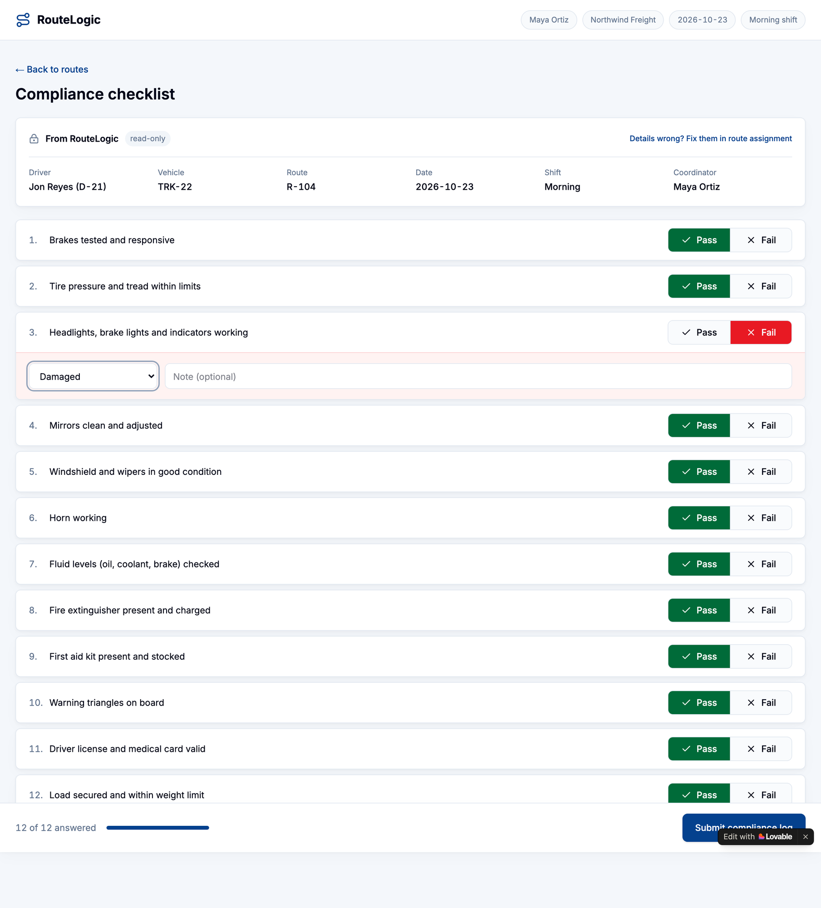
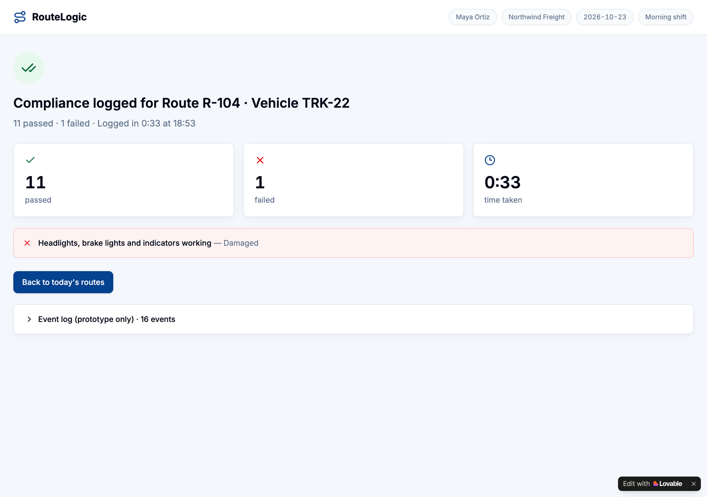
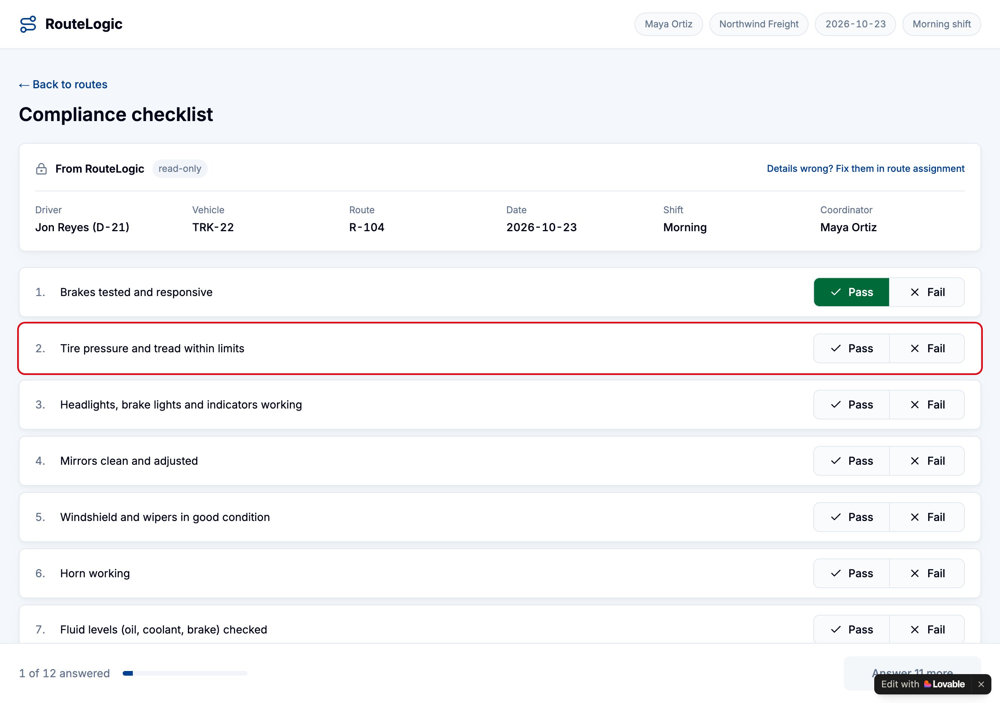

# PRD & Prototype Sprint

Module 4 · Lab 2. Scenario: RouteLogic Velocity. Full PRD: [`simplified-prd.md`](simplified-prd.md).

## Responses

### Pick & scope with MoSCoW

**The “Now” feature I’m scoping (name + one-line core description)**

B1 One-Click Compliance Checklist. One screen, opened in one tap from the route the coordinator just assigned. Driver, vehicle, route, date, shift and coordinator are pre-filled, each check takes one tap, and the log submits once.

**My finalized Must-Haves (after overriding the AI)**

1. **M1** One-screen checklist, opened in one tap from the assigned route.
2. **M2** Auto-fill of system data only, read-only.
3. **M3** One tap per item, nothing pre-answered.
4. **M4** A reason from a pick list for every Fail.
5. **M5** Submit blocked until every item has an answer, then saved in one action in the existing record format.
6. **M6** Event logging: checklist opened, item answered, submitted, time taken.

M6 is my override. The AI listed it as a pilot prerequisite, not a must-have, because logging works without it. But without it the pilot cannot read the primary metric, 48% to 60%.

**What I demoted from Must → Should/Won’t, and why**

B5's "compliance not yet logged" marker, from part of the Now build to a should-have (S1). In Lab 1 I planned it inside B1. The kill test moves it out: coordinators can log every check in about 3 minutes without it. It nudges completion, but it does not make logging faster. I also kept S5, a separate checklist per account, as a should-have. It becomes a must-have only if the 3 pilot accounts turn out to use different checklists.

### Generate your Simplified PRD

**One thing my PRD makes explicit that a vague brief would have missed**

Speed must never come from guessing. Every item starts blank, there is no "mark all as pass", and every saved result must match a tap event (FR3 and Edge case 7). A vague brief like "make compliance one click" invites pre-ticked passes. That is the fastest build, and it breaks the records guardrail. The PRD also states its main assumption: a 12-item checklist. The real item count is still open, and it decides whether 3 minutes is realistic.

### Prompt-to-prototype sprint

**Where did the prototype reveal a gap in my PRD logic? (what I had to update)**

The counter. With all 12 checks answered but one Fail still missing its reason, the first build showed "11 of 12 answered · Answer 1 more". The coordinator could not tell that a reason was missing. My PRD never defined how a Fail without a reason counts. I updated the PRD: a Fail counts as answered, and Submit reads "Add 1 reason" until every Fail has one. The second build shows "12 of 12 answered · Add 1 reason".

The first build also missed Smart Behavior 4: an early Submit did not show which check was open. I referenced the PRD row by name, and the second build outlines the first open check in red. One small gap remains: with the reason "Other" and no note yet, Submit still reads "Answer 1 more" instead of asking for the note.

**My prototype, as a link or a screenshot (publish or share from your tool; in Lovable that is Share → Share Preview, in Bolt Publish → Web. No share URL? Screenshot the working flow)**

[route-ready-checklist.lovable.app](https://route-ready-checklist.lovable.app), built in Lovable from the Simplified PRD. I tested it against every functional requirement, smart behavior and edge case in the PRD. All rules hold in the second build. Only the small label gap above remains.

## Alignment handshake

The PRD and the prototype go to each stakeholder together, never one without the other.

| Stakeholder | What they see | What I ask for |
|---|---|---|
| Manager | The prototype run on route R-104, then the success metric and guardrail | A green light on the problem and on 48% to 60% as the pilot target |
| Eng Lead | The smart behaviors, edge cases and the tap-event safety guard | Feasibility in two weeks, and simpler ways to get the same logic |
| Design Lead | The validated happy path and the three screens | A high-fidelity design for the checklist row and the fail-reason panel |

