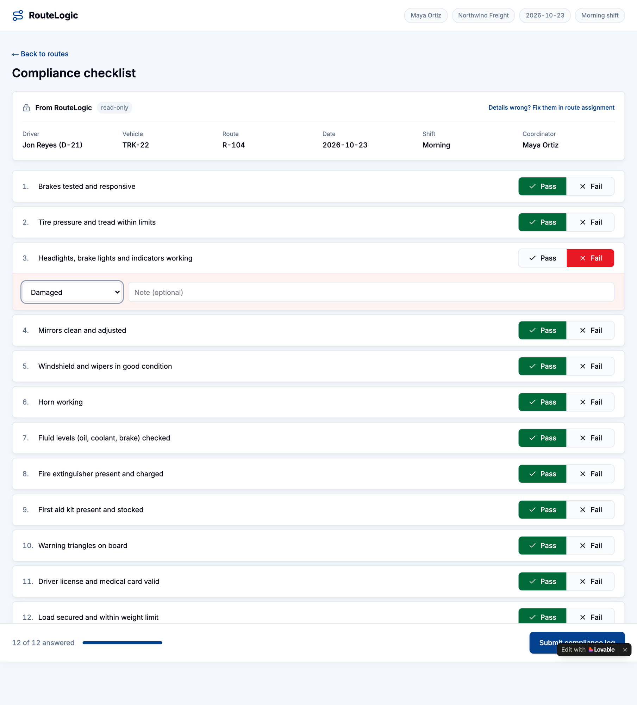
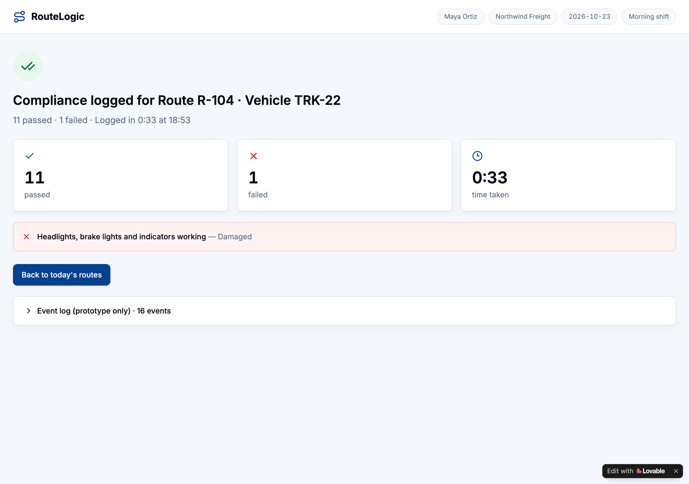
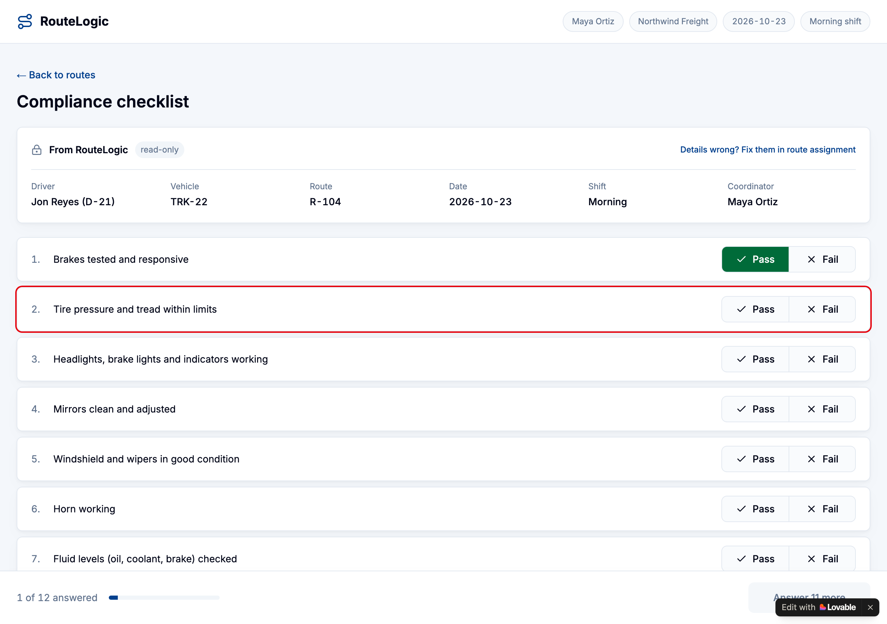

# PRD & Prototype Sprint

Module 4 · Lab 2. Scenario: RouteLogic Velocity. Full PRD: [`simplified-prd.md`](simplified-prd.md).

**Refined on 2026-11-02.** The specification now distinguishes validation feedback from saving, adds date to the production duplicate key, and labels the 3-minute median as an unproven usability bar. These edits do not change the hosted prototype. The remaining label gap and session-only state are recorded below.

## Responses

### Pick & scope with MoSCoW

**The “Now” feature I’m scoping (name + one-line core description)**

B1 One-Click Compliance Checklist. One screen, opened in one tap from the route the coordinator just assigned. Driver, vehicle, route, date, shift and coordinator are pre-filled, each check takes one tap, and the log submits once.

**My finalized Must-Haves (after overriding the AI)**

1. **M1** One-screen checklist, opened in one tap from the assigned route.
2. **M2** Auto-fill of system data only, read-only.
3. **M3** One tap per item, nothing pre-answered.
4. **M4** A reason from a pick list for every Fail.
5. **M5** Submit blocked until every item has an answer, then saved in one action in the existing record format.
6. **M6** Event logging: checklist opened, item answered, submitted, time taken.

M6 is my override. The AI listed it as a pilot prerequisite, not a must-have, because logging works without it. It is needed for the interaction trace. The pilot also needs roster, assignment, both-arm completion and audit data to read +12 points versus concurrent control. [VEL-01 specifies those joins](../05-experimentation/experimentation-plan.md#overview).

**What I demoted from Must → Should/Won’t, and why**

B5's "compliance not yet logged" marker, from part of the Now build to a should-have (S1). In Lab 1 I planned it inside B1. Removing the marker still leaves the core recording flow intact. Whether the flow can meet the proposed 3-minute median needs timed sessions. S5, a separate checklist per account, stays out of this build. VEL-01 excludes mismatched accounts until configuration is scoped and the estimate is approved.

### Generate your Simplified PRD

**One thing my PRD makes explicit that a vague brief would have missed**

Every item starts blank, there is no "mark all as pass", and every saved result must match a tap event (FR3 and Edge case 7). That prevents the interface from inventing answers. It does not prove the physical check happened. The PRD also names the 12-item list as an assumption: verify the actual checklist and checking time before treating 3 minutes as feasible.

### Prompt-to-prototype sprint

**Where did the prototype reveal a gap in my PRD logic? (what I had to update)**

The counter. With all 12 checks answered but one Fail still missing its reason, the first build showed "11 of 12 answered · Answer 1 more". The coordinator could not tell that a reason was missing. My PRD never defined how a Fail without a reason counts. I updated the PRD: a Fail counts as answered, and Submit reads "Add 1 reason" until every Fail has one. The second build shows "12 of 12 answered · Add 1 reason".

The first build also missed Smart Behavior 4: an early Submit did not show which check was open. I referenced the PRD row by name, and the second build outlines the first open check in red. One gap remains in the hosted prototype: with the reason "Other" and no note yet, Submit still reads "Answer 1 more". The revised contract requires "Add a note" for a missing or short Other note. It also states that incomplete Submit can reveal the missing field but cannot save. Those messages must be checked when the build is updated.

**My prototype, as a link or a screenshot (publish or share from your tool; in Lovable that is Share → Share Preview, in Bolt Publish → Web. No share URL? Screenshot the working flow)**

[route-ready-checklist.lovable.app](https://route-ready-checklist.lovable.app), built in Lovable from the Simplified PRD. The original second-build checks covered the functional rules and edge cases then specified. The Other-note label remains wrong. State is held only in the current session, so it does not demonstrate date-key uniqueness after refresh, durable records or an audit-correction integration. The revised contract needs a fresh build check before the pilot. No 15-session coordinator usability study has run.

## Alignment handshake

The PRD and the prototype go to each stakeholder together, never one without the other.

| Stakeholder | What they see | What I ask for |
|---|---|---|
| Manager | Prototype route R-104, the scenario evidence and VEL-01 | Agreement to observe the job first, then test +12 points versus concurrent control with record quality protected |
| Eng Lead | Smart behaviors, date-key uniqueness, production persistence and measurement joins | A feasible estimate after the pre-build evidence gate, including the implementation checks, flag operation and rollback |
| Design Lead | The validated happy path and the three screens | A high-fidelity design for the checklist row and the fail-reason panel |

