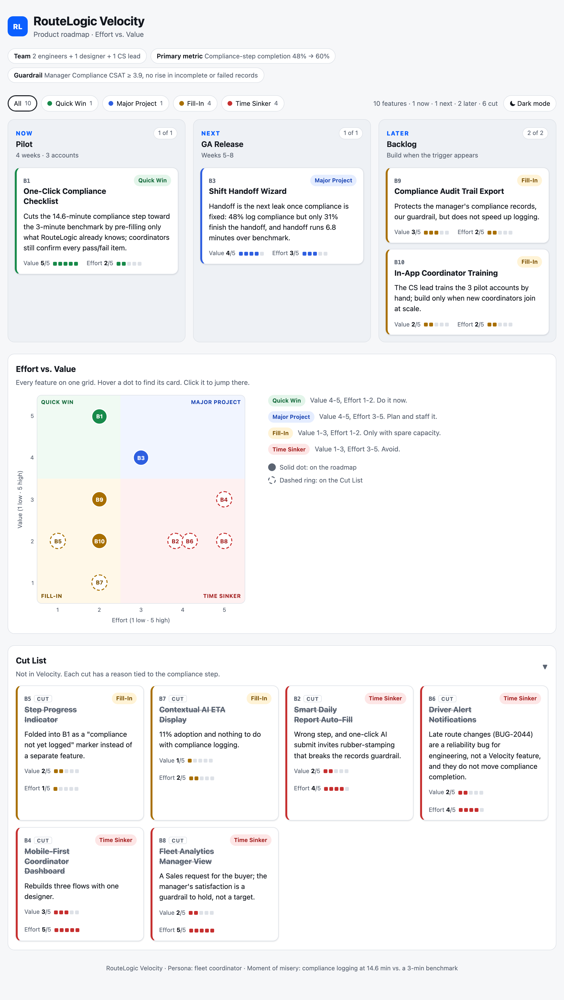
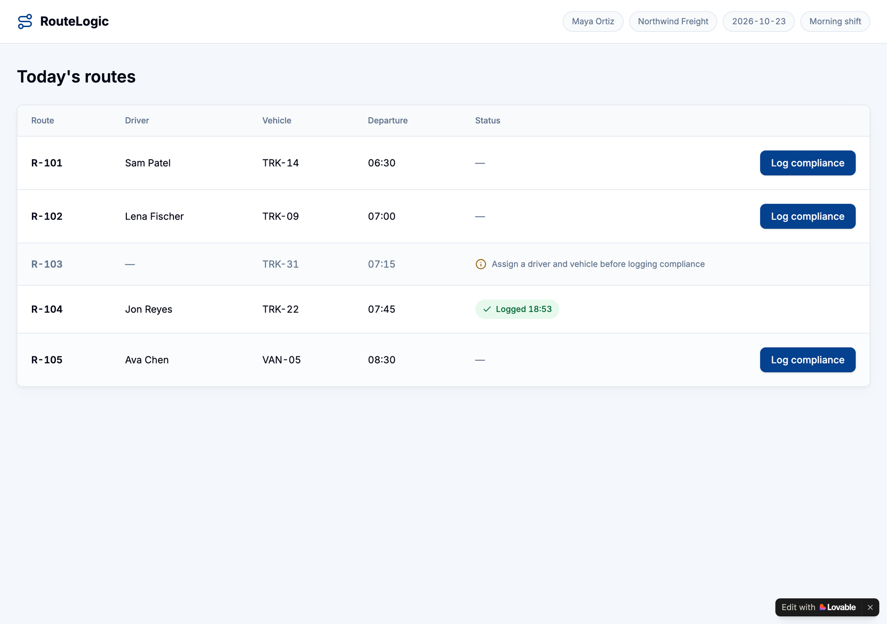

# Roadmap, PRD & Prototype

Module 4 · Deliverable 4. Scenario: RouteLogic Velocity. Team: 2 engineers, 1 designer and 1 CS lead, with a 4-week pilot at 3 accounts.

## Your strategic anchors

**Persona (M2), who are you solving for?**

A fleet coordinator, the dispatcher in our research, who assigns routes, logs compliance checks and hands off shifts every day.

**Primary success metric (M3), your leading indicator**

Compliance-step completion: the share of coordinators who finish logging compliance checks in RouteLogic. Baseline 48%, target 60%.

**Moment of misery (M2), the specific friction blocking the goal**

Logging compliance checks takes 14.6 minutes against a 3-minute benchmark. It is the step where the daily workflow breaks: 71% finish route assignment, 48% log compliance.

**Guardrail metric (M3), what must not drop or break**

Manager Compliance CSAT stays at 3.9 or higher, and incomplete or failed compliance records do not rise.

## Scan the backlog & set a human baseline

**My instinctive “quick wins” before touching the AI (2 to 3 feature IDs + why)**

- **B1 One-Click Compliance Checklist.** It is the misery itself, and a pre-filled form looks like weeks of work, not months.
- **B6 Driver Alert Notifications.** Push alerts on route changes answer the critical bug from our research (BUG-2044). It looked cheap.
- **B5 Step Progress Indicator.** Cheap, and it shows coordinators where they are. My doubt: it shows the drop-off without removing it.

## Audit, override & decide

**Where did you override the AI? (feature + old vs. new score + why)**

- **B1, Effort 3 → 2.** The AI counted effort 3 as low, which breaks the framework's own cut-off (low means 1 or 2). Pre-filling only what RouteLogic already holds, such as driver, vehicle, route and date, fits in two weeks by my estimate. The engineers have not confirmed it yet.
- **B3, Value 2 → 4.** Handoff is the next leak in the funnel: 48% log compliance, but only 31% finish the handoff. Its 6.8-minute gap is the second largest, and it moves the north-star. It is not a 5 because it does not move the primary metric.
- **B6, Value 1 → 2, still cut.** Late route changes are the dispatcher's own pain too (UXR-02, BUG-2044). But they are a reliability bug for engineering, not a Velocity feature, and they do not move compliance completion.
- **Decisions that differ from the quadrant.** B5 is cut because its marker folds into B1. B7 is cut although it is a Fill-In: 11% adoption, and nothing to do with compliance.

Two of my three instincts were wrong. B6 does not move the metric and costs more than it looked. B5 shows the drop without removing it.

**Did the AI over-value a Sales/Eng request your M2 interviews don’t support?**

No. It was ruthless with both: the Sales request B8 scored 2 and the Engineering favourite B7 scored 1. The one item it valued above our interview evidence is B9, the Legal/CS audit export, at 3. No interview mentions audits. I kept the 3 because the export protects the records our guardrail depends on, and placed it in Later.

**Did it underweight something your M3 cohort/funnel data strongly supports?**

Yes, the Shift Handoff Wizard (B3). The AI scored it 2 because it does not move the 48%. The funnel shows about a third of coordinators leaving at handoff: only 31 of 48 finish it. Once compliance is fixed, handoff becomes the bottleneck for the north-star, so it leads the Next lane.

## Scoring

Final scores after the audit. Value is the lift on compliance-step completion. Effort is engineering cost for the pilot team. Quadrants follow the builder's rule: high value is 4 or 5, low effort is 1 or 2.

| Feature | Value | Effort | Quadrant | Decision | Rationale |
|---|---|---|---|---|---|
| B1 One-Click Compliance Checklist | 5 | 2 | Quick Win | Now | Pre-fills what RouteLogic already knows, so the 14.6-minute step moves toward 3 minutes. Coordinators still confirm every item. |
| B2 Smart Daily Report Auto-Fill | 2 | 4 | Time Sinker | Cut | Wrong step. One-click AI submits invite rubber-stamping, which puts the records guardrail at risk. |
| B3 Shift Handoff Wizard | 4 | 3 | Major Project | Next | The next leak after compliance: 31 of 48 finish the handoff, which runs 6.8 minutes over benchmark. |
| B4 Mobile-First Coordinator Dashboard | 3 | 5 | Time Sinker | Cut | Rebuilds three flows with one designer. |
| B5 Step Progress Indicator | 2 | 1 | Fill-In | Cut | Shows the drop without removing it. Its marker folds into B1 as a should-have. |
| B6 Driver Alert Notifications | 2 | 4 | Time Sinker | Cut | Late route changes (BUG-2044) are a bug for engineering and do not move compliance completion. |
| B7 Contextual AI ETA Display | 1 | 2 | Fill-In | Cut | 11% adoption and nothing to do with compliance logging. |
| B8 Fleet Analytics Manager View | 2 | 5 | Time Sinker | Cut | A Sales request for the buyer. Manager satisfaction is a guardrail to hold, not a target. |
| B9 Compliance Audit Trail Export | 3 | 2 | Fill-In | Later | Protects the records the guardrail depends on, but does not speed up logging. |
| B10 In-App Coordinator Training | 2 | 2 | Fill-In | Later | The CS lead trains the 3 pilot accounts by hand. |

## Generate your interactive roadmap

**My “Now” lane (this sprint), the 2 to 3 quick wins I’ll build first**

One item, on purpose: B1 One-Click Compliance Checklist. B5's "compliance not yet logged" marker folds into it as a should-have. The primary metric depends on one step, and the pilot has two engineers for four weeks. A second Now item would split them.

**What I cut, and the “no” I’m protecting the scope from**

Six cuts: B2 report auto-fill, B4 mobile dashboard, B6 driver alerts, B7 AI ETAs, B8 manager analytics, and B5 as a separate feature. The "no" is to anything that does not touch the compliance step during the pilot. It protects both engineers' four weeks for B1. Cutting B2 also keeps one-click AI submits away from compliance records, which would put the guardrail at risk.

**Prototype/roadmap screenshot link (paste into your deliverables)**

[`roadmap.html`](roadmap.html), the interactive roadmap, with a screenshot below.

## High-level product roadmap

### NOW, Pilot (4 weeks, 3 accounts)
- **B1 One-Click Compliance Checklist**, the only Now item. At week 4 we read completion against 60%, logging time against 3 minutes, failed or incomplete records, and manager CSAT at 3.9 or higher. The return at target is 11.6 minutes back per coordinator per day, for about two weeks of build by both engineers.

### NEXT, GA Release (weeks 5-8)
- **B3 Shift Handoff Wizard**, the next leak in the funnel. B1 rolls out to all accounts if the pilot passes.

### LATER, backlog
- **B9 Compliance Audit Trail Export**, if B1 ships early or audits come up.
- **B10 In-App Coordinator Training**, when new coordinators join at scale.

### ✂ Cut List
- **B2, B4, B5, B6, B7, B8.** Each misses the compliance step or does not fit the pilot. Late route changes (B6) go to engineering as a bug.

**Dependencies and stakeholder review**

- B1 depends on clean route data. A route without a driver or vehicle cannot open a checklist, so dispatch data quality is a pilot risk.
- B1 keeps the existing compliance record format. Compliance and Legal review the checklist items and confirm nothing changes in what is legally required.
- B3 and B9 both build on B1's records, so neither starts before B1 ships.
- The roadmap is re-scored at the week-4 pilot read-out, with the new evidence.

The balance is almost all core work, the 70% share: B1 and B3 fix an existing workflow. B9 is the adjacent 20%, protecting the buyer's records. There is no 10% innovation bet in the pilot. The one candidate, B2's AI auto-fill, is cut for its guardrail risk.

## PRD snippets

The key elements of the Simplified PRD for B1. The full version is in [`simplified-prd.md`](simplified-prd.md).

- **Vision:** a fleet coordinator logs every compliance check in about 3 minutes, right after assigning the route. No check counts as passed unless the coordinator confirmed it.
- **Success metrics:** compliance-step completion from 48% to 60% in the pilot. Guardrail: no rise in incomplete or failed records, and manager Compliance CSAT at 3.9 or higher.
- **MVP core value and happy path:** one outcome, a complete compliance log in about 3 minutes. The shortest path is route list, then 12 one-tap checks with a reason on any Fail, then submit and confirmation.
- **Core rules:** the checklist opens in one tap from the assigned route. Six header fields come pre-filled and read-only. Every item starts blank and takes one tap. A Fail needs a reason. Submit stays blocked until every item has an answer.
- **Guard against made-up answers:** every saved result must match a tap event. There is no "mark all as pass".
- **Evals:** median time to submit of 3:00 or less, 100% complete records, and zero safety triggers before the pilot starts.

## Wireframes / prototype

Clickable prototype of B1: [route-ready-checklist.lovable.app](https://route-ready-checklist.lovable.app). The full sprint is in [`prd-and-prototype.md`](prd-and-prototype.md).

