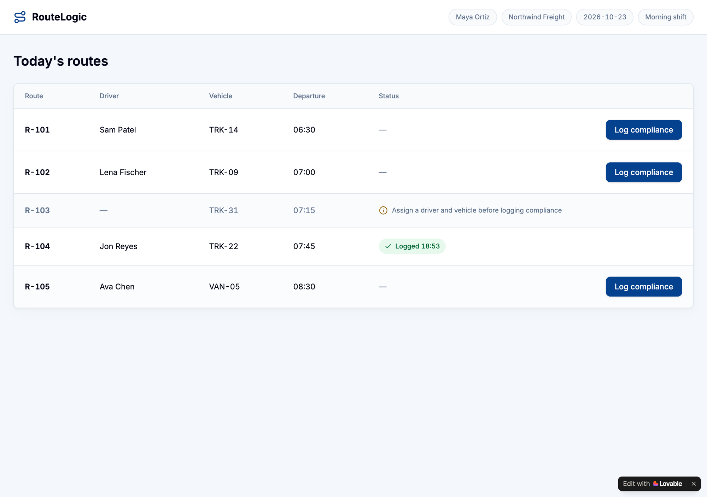
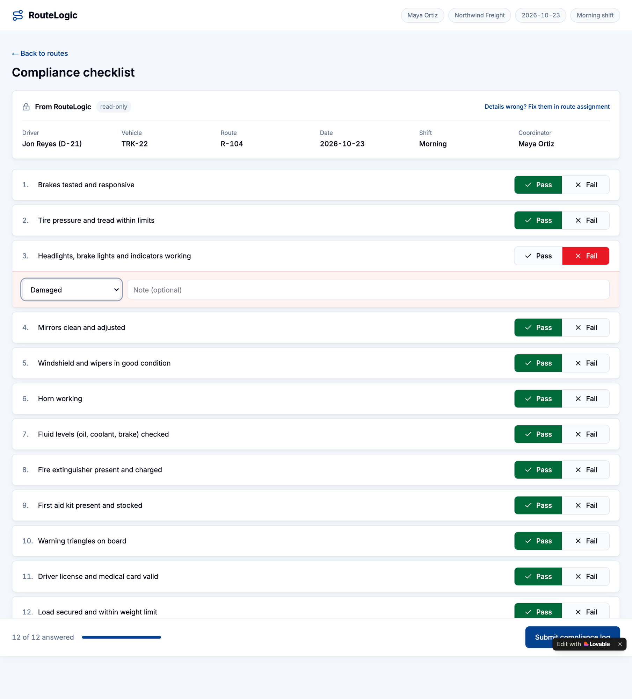
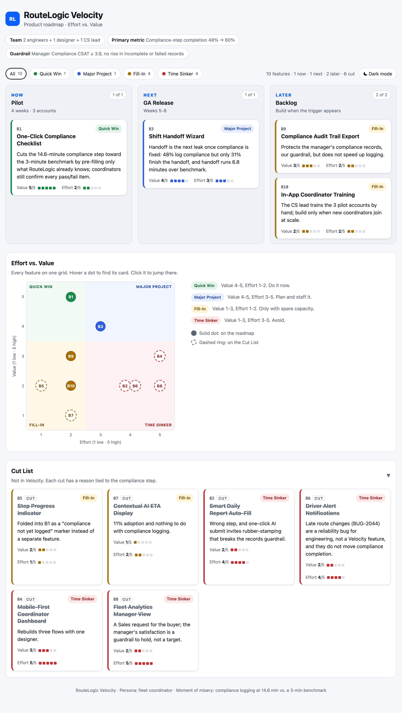

# Roadmap, PRD & Prototype

Module 4 · Deliverable 4. Scenario: RouteLogic Velocity. Proposed team: 2 engineers, 1 designer and 1 CS lead for a 4-week pilot at 3 accounts.

**Refined on 2026-11-02.** The four-week plan starts after VEL-01's pre-build evidence gate passes. Build weeks 1 and 2 are followed by a pre-exposure implementation gate. A failed implementation check delays randomization and the read. The 14.6-minute source is a scenario mean, not a measured saving. The prototype median of 3 minutes is an unproven usability bar. B3 is a candidate for validation after B1, not an approved weeks-5-to-8 build.

## Your strategic anchors

**Persona (M2), who are you solving for?**

A fleet coordinator, the dispatcher in our research, who assigns routes, logs compliance checks and hands off shifts every day.

**Primary success metric (M3), your leading indicator**

Daily compliance completion on scheduled workdays fixed before assignment, including non-use as zero. The target is +12 points versus concurrent control. The scenario illustration is 48% → 60%, but its app-opener baseline must be validated on the experimental denominator. [VEL-01 defines the estimator and readiness gate](../05-experimentation/experimentation-plan.md).

**Moment of misery (M2), the specific friction blocking the goal**

The scenario mean is 14.6 minutes against a 3-minute benchmark. Completion falls from 71% at route assignment to 48% at compliance. Whether navigation or recording friction causes the drop is unproven and must be observed before build.

**Guardrail metric (M3), what must not drop or break**

Accuracy deterioration may not exceed 2 points versus concurrent control. A Fail-rate ratio below 0.5 triggers an audit and pauses shipping. The compliance owner agrees these planning boundaries before exposure. Manager CSAT is a descriptive trust signal. [VEL-01 owns the definitions and safety actions](../05-experimentation/experimentation-plan.md).

## Scan the backlog & set a human baseline

**My instinctive “quick wins” before touching the AI (2 to 3 feature IDs + why)**

- **B1 One-Click Compliance Checklist.** It is the misery itself, and a pre-filled form looks like weeks of work, not months.
- **B6 Driver Alert Notifications.** Push alerts on route changes answer the critical bug from our research (BUG-2044). It looked cheap.
- **B5 Step Progress Indicator.** Cheap, and it shows coordinators where they are. My doubt: it shows the drop-off without removing it.

## Audit, override & decide

**Where did you override the AI? (feature + old vs. new score + why)**

- **B1, Effort 3 → 2.** The AI counted effort 3 as low, which breaks the framework's own cut-off (low means 1 or 2). Pre-filling only what RouteLogic already holds, such as driver, vehicle, route and date, fits in two weeks by my estimate. The engineers have not confirmed it yet.
- **B3, Value 2 → 4.** Handoff is the next leak in the funnel: 48% log compliance, but only 31% finish the handoff. Its 6.8-minute gap is the second largest, and it moves the north-star. It is not a 5 because it does not move the primary metric.
- **B6, Value 1 → 2, still cut.** Late route changes are the dispatcher's own pain too (UXR-02, BUG-2044). But they are a reliability bug for engineering, not a Velocity feature, and they do not move compliance completion.
- **Decisions that differ from the quadrant.** B5 is cut because its marker folds into B1. B7 is cut although it is a Fill-In: 11% adoption, and nothing to do with compliance.

Two of my three instincts were wrong. B6 does not move the metric and costs more than it looked. B5 shows the drop without removing it.

**Did the AI over-value a Sales/Eng request your M2 interviews don’t support?**

No. It was ruthless with both: the Sales request B8 scored 2 and the Engineering favourite B7 scored 1. The one item it valued above our interview evidence is B9, the Legal/CS audit export, at 3. No interview mentions audits. I kept the 3 because the export protects the records our guardrail depends on, and placed it in Later.

**Did it underweight something your M3 cohort/funnel data strongly supports?**

Yes, the Shift Handoff Wizard (B3). The AI scored it 2 because it does not move the 48%. The funnel shows about a third of coordinators leaving at handoff: only 31 of 48 finish it. If the compliance result holds, observe handoff next to see whether it becomes the constraint. B3 leads the Next lane as a validation candidate.

## Scoring

Final scores after the audit. Value is the lift on compliance-step completion. Effort is engineering cost for the pilot team. Quadrants follow the builder's rule: high value is 4 or 5, low effort is 1 or 2.

| Feature | Value | Effort | Quadrant | Decision | Rationale |
|---|---|---|---|---|---|
| B1 One-Click Compliance Checklist | 5 | 2 | Quick Win | Now | Tests whether reusing verified route fields and a single checklist removes observed recording friction. Every check still needs an answer. |
| B2 Smart Daily Report Auto-Fill | 2 | 4 | Time Sinker | Cut | Wrong step. One-click AI submits invite rubber-stamping, which puts the records guardrail at risk. |
| B3 Shift Handoff Wizard | 4 | 3 | Major Project | Next | The next leak after compliance: 31 of 48 finish the handoff, which runs 6.8 minutes over benchmark. |
| B4 Mobile-First Coordinator Dashboard | 3 | 5 | Time Sinker | Cut | Rebuilds three flows with one designer. |
| B5 Step Progress Indicator | 2 | 1 | Fill-In | Cut | Shows the drop without removing it. Its marker folds into B1 as a should-have. |
| B6 Driver Alert Notifications | 2 | 4 | Time Sinker | Cut | Late route changes (BUG-2044) are a bug for engineering and do not move compliance completion. |
| B7 Contextual AI ETA Display | 1 | 2 | Fill-In | Cut | 11% adoption and nothing to do with compliance logging. |
| B8 Fleet Analytics Manager View | 2 | 5 | Time Sinker | Cut | A Sales request for the buyer. Manager satisfaction is a guardrail to hold, not a target. |
| B9 Compliance Audit Trail Export | 3 | 2 | Fill-In | Later | Protects the records the guardrail depends on, but does not speed up logging. |
| B10 In-App Coordinator Training | 2 | 2 | Fill-In | Later | The CS lead trains the 3 pilot accounts by hand. |

## Generate your interactive roadmap

**My “Now” lane (this sprint), the 2 to 3 quick wins I’ll build first**

B1 One-Click Compliance Checklist is the only Now item. B5's "compliance not yet logged" marker folds into it as a should-have. The primary metric depends on one step, and the pilot has two engineers for four weeks. A second Now item would split them.

**What I cut, and the “no” I’m protecting the scope from**

Six cuts: B2 report auto-fill, B4 mobile dashboard, B6 driver alerts, B7 AI ETAs, B8 manager analytics, and B5 as a separate feature. We will not add work outside the compliance step to this pilot because the proposed team must build and test B1. B2 also introduces inferred answers into records that need explicit coordinator responses.

**Prototype/roadmap screenshot link (paste into your deliverables)**

[`roadmap.html`](roadmap.html), the interactive roadmap, with a screenshot below.

## High-level product roadmap

### NOW, Pilot (4 weeks, 3 accounts)
- **Before build:** pass VEL-01's evidence gate: observed mechanism, checklist fit, enrollment and power, feasible measurement/audit design and staffing. Hold the build if the mechanism or sample does not fit.
- **B1 One-Click Compliance Checklist**, the only Now item. Build weeks 1 and 2 implement the flow. Before exposure, verify both-arm telemetry, production write guards, 15 usability sessions and the canary. A failure holds randomization and moves the read while retaining the full 14-day test. The day-14 read follows [VEL-01's ordered decision rules](../05-experimentation/experimentation-plan.md#formalize-your-hypothesis--shipping-criteria), not an absolute 60% result. Safety monitoring can stop the variant earlier. The return is evidence about completion, quality and usability, not a promised number of minutes saved.

### NEXT, GA Release (weeks 5-8)
- **B1 rollout, conditional:** the weeks-5-to-8 window is provisional, measured after the pre-build evidence gate passes. Eligible matching-checklist accounts expand only on a ship decision and the GTM wave gates. Delays move the window.
- **B3 Shift Handoff Wizard, validation candidate:** observe the handoff after B1. Build approval requires sustained complete-day logging without confirmed harm, validation that B3 addresses the remaining obstacle, and confirmed engineering and design capacity. B1's result alone does not authorize B3.

### LATER, backlog
- **B9 Compliance Audit Trail Export**, only if an observed audit gap justifies it and capacity is approved. It is not spare work inside the B1 experiment.
- **B10 In-App Coordinator Training**, when new coordinators join at scale.

### ✂ Cut List
- **B2, B4, B5, B6, B7, B8.** Each misses the compliance step or does not fit the pilot. Late route changes (B6) go to engineering as a bug.

**Dependencies and stakeholder review**

- B1 depends on clean route data. A route without a driver or vehicle cannot open a checklist, so dispatch data quality is a pilot risk.
- B1 keeps the existing compliance record format. Compliance and Legal review the checklist items and confirm nothing changes in what is legally required.
- B3 and B9 need separate problem validation and capacity approval after B1. Neither is authorized by this pilot.
- The proposed two-week B1 estimate must include control and variant telemetry, roster joins, flag operation, audit support and rollback. If those do not fit, simplify scope or move the start before locking the protocol. The test retains its full 14 days.
- The roadmap is re-scored at the week-4 pilot read-out, with the new evidence.

Using the course's 70/20/10 horizon lens, B1 and the B3 candidate are core workflow work. B9 is adjacent. These are categories, not measured staffing allocations. The pilot funds only B1. It includes no innovation bet: B2's AI auto-fill is cut for its record-quality risk.

## PRD snippets

The key elements of the Simplified PRD for B1. The full version is in [`simplified-prd.md`](simplified-prd.md).

- **Vision:** a coordinator can record compliance from the assigned route with every answer explicit. Prototype median ≤ 3 minutes is a usability hypothesis to test after observing the job.
- **Success metrics:** +12 points in completed daily logging versus concurrent control, with VEL-01's sample, uncertainty, persistence and quality conditions met. Manager CSAT informs investigation, not the randomized effect.
- **MVP core value and happy path:** route list, read-only header, 12 blank checks with a reason on any Fail, then submit and confirmation. Completeness records explicit answers, not proof that physical inspections occurred.
- **Core rules:** the checklist opens in one tap from the assigned route. Six header fields come pre-filled and read-only. Every item starts blank and takes one tap. A Fail needs a reason. Submit stays blocked until every item has an answer.
- **Guard against automatic answers:** every saved result must match a tap event. There is no "mark all as pass". Record audits still need to check truthfulness.
- **Evals:** proposed median time to submit ≤ 3:00 in 15 usability sessions, plus deterministic record validation and edge-case checks. These do not establish production accuracy or time savings. [The PRD](simplified-prd.md#evals) separates build checks from VEL-01's pilot gate.

## Wireframes / prototype

Clickable prototype of B1: [route-ready-checklist.lovable.app](https://route-ready-checklist.lovable.app). The full sprint is in [`prd-and-prototype.md`](prd-and-prototype.md).

## Historical roadmap screenshot

The original Module 4 screenshot below predates the 2026-11-02 review. Its automatic B3 schedule and time-saving assumption are superseded. [The current interactive roadmap](roadmap.html) is the authoritative plan.

