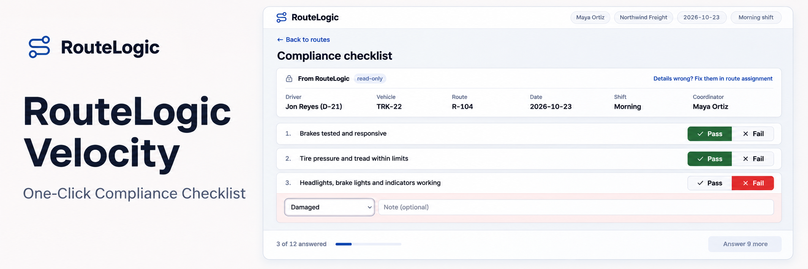

# RouteLogic Velocity

A Product Management Foundations final project by **Antje Barth**. A focused proposal to improve fleet coordinators' compliance logging while preserving the records managers rely on.

**[View the presentation](https://antje.github.io/product-school-product-management-foundations/06-launch/final-presentation.html)** · **[Try the prototype](https://route-ready-checklist.lovable.app/)**

## Executive path

- **Problem.** In the course scenario, coordinator completion falls from 71% at route assignment to 48% at compliance logging. The compliance step averages 14.6 minutes against a supplied 3-minute benchmark. Our largest account is evaluating a leaner rival. [Problem hook](01-product-thinking/problem-hook.md) · [Metrics](03-analytics/hypothesis-and-metrics.md)
- **Proposed solution.** B1, the One-Click Compliance Checklist, reuses route details and asks for an explicit answer to each of 12 checks. It tests whether recording friction contributes to the completion gap. The physical checks still have to happen. [PRD](04-roadmap/simplified-prd.md) · [Prototype review](04-roadmap/prd-and-prototype.md)
- **Evidence today.** Twelve interview notes, ten bug reports and three metric snapshots supplied by the course. They establish frontline friction, but none of the interviews describes compliance logging. The prototype uses mock data. No pilot or 15-session usability study has run.
- **Why RouteLogic.** The opportunity is to make daily entry easier inside the system whose reporting buyers already value (UXR-10). A competitor can copy a checklist. The proposed advantage is its fit with the existing route workflow and record format. [Competitive reasoning](02-discovery/competitive-and-journey.md)
- **Decision requested.** Approve discovery and protocol work first. Release the proposed four-week pilot capacity—two engineers, one designer and one CS lead at three accounts—only after workflow, checklist fit, eligible enrollment and power are confirmed. Compliance review and PM ownership are also required. [Roadmap](04-roadmap/roadmap-prd-prototype.md)
- **Test and decision.** VEL-01 compares completed daily logs with concurrent control over 14 days. Ship only with at least +12 percentage points, statistical support, audited record quality and the account/persistence conditions. The scenario's 48% → 60% is an illustration, not a measured outcome or an absolute shipping rule. Severe harm can stop the test early. [Full protocol and ordered decisions](05-experimentation/experimentation-plan.md)
- **What the pilot returns.** A completion effect with uncertainty, an audited quality assessment, usability evidence and a ship, iterate or kill decision. Enrollment of 540 coordinators, checklist fit and a 3-minute prototype median remain unverified. [GTM and dashboard](06-launch/gtm-and-dashboard.md)

## Deliverables at a glance

| Area | Completed artifact |
|---|---|
| Product thinking | [Problem hook, value proposition and hypothesis](01-product-thinking/problem-hook.md) · [Strategic discovery map exercise](01-product-thinking/strategic-map.md) |
| Discovery | [Research synthesis and AI audit](02-discovery/ai-synthesis.md) · [Competitive analysis and coordinator journey](02-discovery/competitive-and-journey.md) · [Visual journey](https://antje.github.io/product-school-product-management-foundations/02-discovery/journey-map.html) |
| Analytics | [Hypothesis and success metrics](03-analytics/hypothesis-and-metrics.md) |
| Roadmap and prototype | [Prioritization and roadmap](04-roadmap/roadmap-prd-prototype.md) · [Visual roadmap](https://antje.github.io/product-school-product-management-foundations/04-roadmap/roadmap.html) · [Simplified PRD](04-roadmap/simplified-prd.md) · [Prototype sprint and checks](04-roadmap/prd-and-prototype.md) |
| Experimentation | [VEL-01 experiment plan](05-experimentation/experimentation-plan.md) |
| Launch | [GTM strategy and success dashboard](06-launch/gtm-and-dashboard.md) · [Individual insights](06-launch/individual-insights.md) |
| Final presentation | [Published deck](https://antje.github.io/product-school-product-management-foundations/06-launch/final-presentation.html) · [Standalone HTML file](06-launch/final-presentation.html) · [Presentation sources](06-launch/final-presentation.md) |

## Evidence and scope

The initial discovery focused on drivers and delivery confirmation. Workflow and satisfaction data moved the priority to coordinators and compliance logging. The original driver journey remains available alongside the current coordinator journey.

VEL-01 is the source for measurement, readiness and decision rules. Its primary measure includes all scheduled workdays fixed before assignment, counting non-use as zero. The scenario's app-opener funnel uses a different denominator, so baseline and power must be re-estimated before build. A separate implementation gate verifies telemetry, write guards, usability and the canary before randomization.

The checklist prototype demonstrates interaction rules, not production persistence, legal compliance, record truthfulness or measured time savings. Known limitations and the remaining “Other” reason-label issue are documented in the [prototype sprint](04-roadmap/prd-and-prototype.md).

## The project in one sentence

RouteLogic Velocity tests whether a simpler compliance checklist helps coordinators complete their daily logs while preserving record quality.
